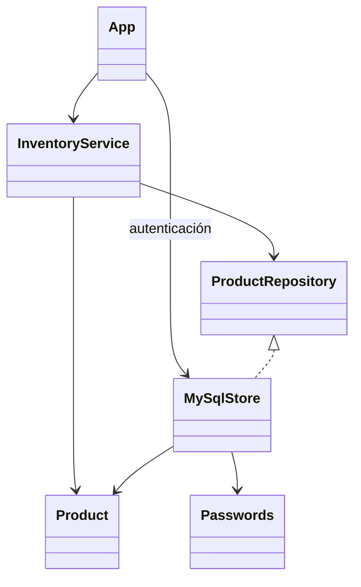

# Diseño técnico

## Capas

| Capa | Clases | Responsabilidad |
|---|---|---|
| Presentación | App | Formularios, tabla, filtros, confirmaciones y mensajes |
| Dominio | Product | Entidad inmutable y validaciones |
| Servicio | InventoryService | Reglas de movimientos y operaciones |
| Contrato | ProductRepository | Desacoplar la persistencia del dominio |
| Persistencia | MySqlStore | JDBC, consultas preparadas y cierre de conexiones |
| Seguridad | Passwords | PBKDF2-HMAC-SHA256, 600000 iteraciones, sal de 16 bytes |
| Errores | InventoryException | Propagar mensajes comprensibles con causa técnica |

## Relaciones

## Modelo de datos

productos: code PK, name, description, category, price DECIMAL(11,2), quantity INT y version BIGINT.
usuarios: id PK fijo en 1, username UNIQUE, salt y password_hash.

No hay relación entre tablas porque esta versión utiliza un administrador para operar el catálogo completo. No almacena contraseñas en texto claro. El esquema impone unicidad y cantidades/precios no negativos además de validar en Java.

## Consistencia

Cada escritura usa una conexión con autoCommit y una sola sentencia. No necesita una transacción de varias sentencias. La actualización de existencias utiliza una expresión SQL y un predicado de disponibilidad dentro del mismo UPDATE. version permite detectar ediciones, movimientos o eliminaciones basados en datos obsoletos. Si no se afecta exactamente una fila, se solicita recargar.

Una pérdida de conexión puede ocurrir después de que MySQL confirme una escritura; por eso el mensaje indica consultar antes de repetir. No se promete que toda excepción de red equivalga a una operación deshecha.

El dinero usa BigDecimal y DECIMAL; no usa float ni double. El formato acepta punto o coma decimal sin separadores de miles. Stock máximo: 2147483647; precio máximo: 999999999.99.

SwingWorker ejecuta el acceso a MySQL fuera del EDT. Los resultados actualizan Swing en done(). Las conexiones, sentencias y resultados se liberan mediante try-with-resources.

## Continuidad con la investigación

Se mantienen el inventario, la separación de responsabilidades, las validaciones y las excepciones. La consola se sustituye por Swing y el archivo de texto se sustituye por MySQL según el cambio solicitado. No se modifica la investigación histórica para hacer parecer que ya usaba SQL.

## Referencias técnicas

- https://dev.mysql.com/doc/relnotes/connector-j/en/news-9-6-0.html
- https://dev.mysql.com/doc/connector-j/en/connector-j-java-8.html

